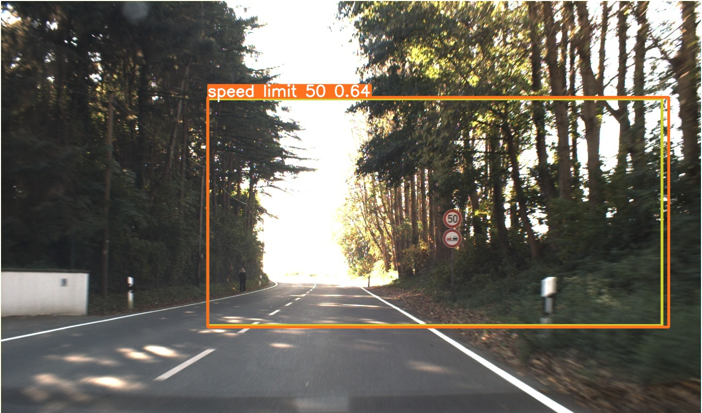
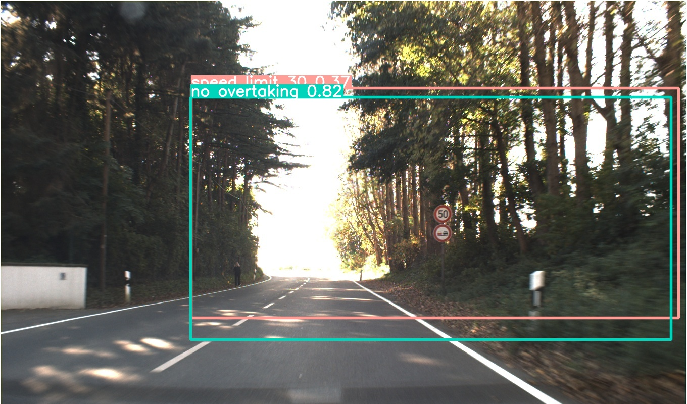
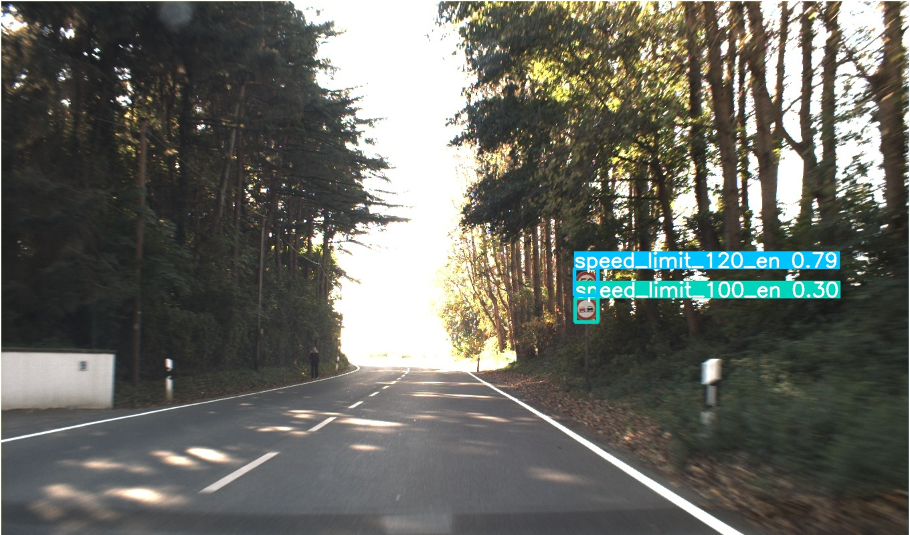

# 🚦 Real-Time Traffic Sign Detection Using YOLOv8

<div align="center">

[](https://www.python.org/)
[](https://pytorch.org/)
[](https://opencv.org/)
[]()
[]()
[](https://ai.hacettepe.edu.tr/)

**An end-to-end Computer Vision system for real-time traffic sign detection and classification on German road benchmark datasets (GTSDB & Roboflow) utilizing YOLOv8 and automated augmentation pipelines.**

[Overview](#-overview) • [Model Evolution & Results](#-model-benchmarks--visual-progression) • [Detection Pipeline](#-inference--detection) • [Repository Structure](#-repository-structure) • [Presentation](#-presentation--resources)

</div>

---

## 📌 Overview

Accurate, low-latency traffic sign detection is a mission-critical component of Autonomous Vehicles (AV) and Advanced Driver Assistance Systems (ADAS). This project investigates real-time traffic sign detection under varying illumination, scale, motion blur, and weather conditions:

- **Architecture:** Ultralytics YOLOv8 (nano/small variants for edge deployment).
- **Benchmark Datasets:** German Traffic Sign Detection Benchmark (GTSDB) & Roboflow German Traffic Sign Dataset.
- **Data Augmentation:** Quadrupling dataset size using geometric transformations, contrast scaling, and perspective distortion to eliminate small-object false negatives.
- **Real-Time Inference:** Fast inference pipelines supporting both single-frame images and continuous multi-frame road dashcam video streams.

---

## 📊 Model Benchmarks & Visual Progression

Through systematic iterative training across Colab GPU runtimes, the detection accuracy surged from a baseline failure to **98.9% mAP50**:

| Model Version | Epochs | Dataset & Technique | mAP@50 | mAP@50-95 | Key Takeaway / Observation |
| :--- | :---: | :--- | :---: | :---: | :--- |
| **Baseline (YOLOv8)** | 30 | Raw GTSDB (Default params) | ~0.12 | ~0.08 | ❌ Severe underfitting; sparse small-sign annotations. |
| **Model 2** | 50 | Raw GTSDB (Extended epochs) | 0.314 | 0.236 | ⚠️ Noticeable improvement, but still unsatisfactory recall. |
| **Model 3 (Roboflow)** | 50 | Roboflow Balanced Sign Dataset | **0.989** | **0.805** | 🚀 **Breakthrough:** High-density, high-quality bounding box labels. |
| **Model 4 (Augmented)** | 30 | 4x Augmented Training Split | **0.971** | **0.868** | 🎯 **Best Generalization:** Maximum IoU accuracy across multi-scale signs. |

### 🖼️ Qualitative Detection Comparison on Difficult Test Frame

| Baseline Failure (Low Confidence) | Model 2 (Missed Distant Signs) | Model 3 / 4 (Pinpoint Detection) |
| :---: | :---: | :---: |
|  |  |  |

---

## 🚀 Inference & Detection

The project includes ready-to-run scripts for testing trained models on image stills and dashcam video feeds:

### 1. Still Image Inference (`Code/Detection/detection_img.py`)
```bash
python Code/Detection/detection_img.py --source test_image.jpg --weights path/to/best.pt
```

### 2. Live Video Stream Inference (`Code/Detection/detection_video.py`)
```bash
python Code/Detection/detection_video.py --video path/to/dashcam.mp4 --conf 0.40
```

---

## 📂 Repository Structure

```ascii
Traffic-Sign-Detector/
├── Code/
│   ├── Augmentation/            # Dataset expansion & synthetic distortion scripts
│   ├── Detection/               # Single-frame and video inference pipelines
│   │   ├── detection_img.py     # Image detection script
│   │   └── detection_video.py   # Dashcam video detection script
│   ├── Preprocessing/           # Label format conversion (VOC/YOLO) & resizing
│   └── Train/                   # Jupyter training notebooks (Detection_YOLOv8_1 to 8)
├── Dataset/                     # German Traffic Sign splits and annotations
├── images/                      # Benchmark comparison images and visual assets
├── Presentation/                # Academic presentation slides (.pptx)
├── Video Data Result/           # Rendered detection video demos
└── README.md                    # System documentation
```

---

## 🎓 Academic Context & Presentation

This research was developed as part of the **AIN420 Artificial Intelligence Project Course** at **Hacettepe University (Department of Artificial Intelligence Engineering)**.

- 📽️ The complete project slide deck is available at [`Presentation/TRAFFIC SIGN DETECTION.pptx`](Presentation/TRAFFIC%20SIGN%20DETECTION.pptx).

---

<div align="center">
Developed by <a href="https://github.com/huseyin-yigit-ulker">Hüseyin Yiğit Ülker</a>
</div>
